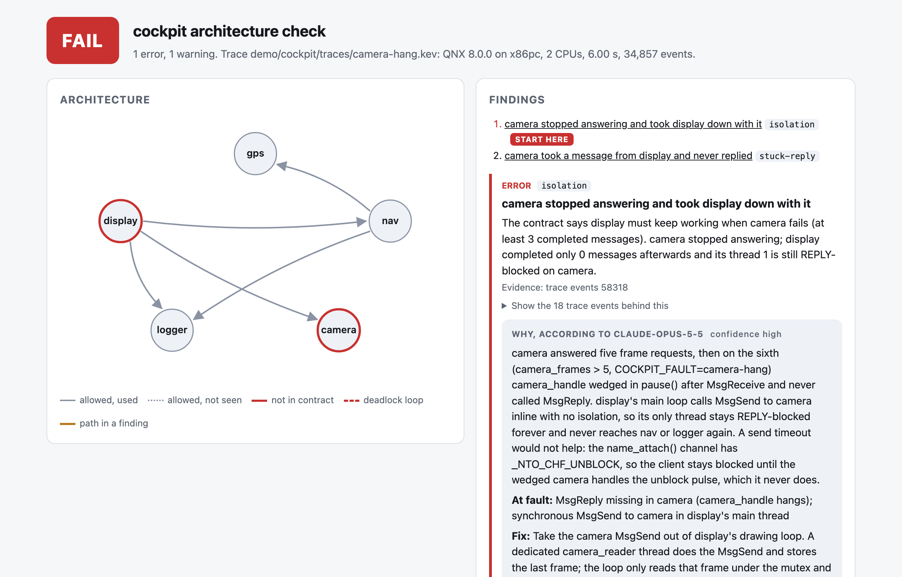
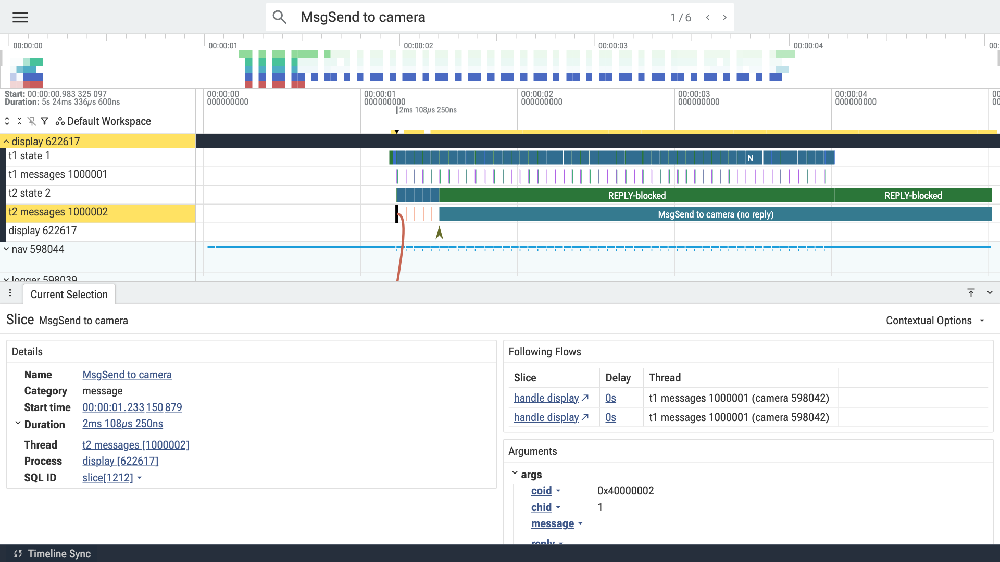
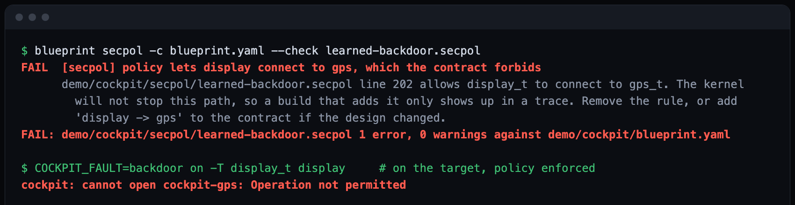

id: blueprint-architecture-contracts
title: Check a QNX system's architecture on every build with Blueprint
summary: Write down which processes may message which, check it against a kernel trace in CI, and let the QNX kernel enforce it. Along the way, two things the docs don't spell out: why a send timeout won't free a REPLY-blocked client, and why secpolgenerate learns nothing while tracelogger runs.
categories: Developer Tools
tags: beginner
difficulty: 2
status: published
authors: Dmytro Topka
feedback_link: https://github.com/DmitriyTopka/qnx-blueprint/issues


# Check a QNX system's architecture on every build with Blueprint

## Welcome
Duration: 1:00

A QNX system is a set of processes that talk through synchronous messages:
a client calls `MsgSend()` and waits until the server calls `MsgReply()`.
That design is what lets one process crash without taking the others with
it. It is also where systems quietly lock up, when a client waits on a server
that never answers.

In this codelab you will:

1. replay a recorded five-process system and see Blueprint catch a deadlock,
   a hung camera and a slow server;
2. write an architecture contract for your own system;
3. record a kernel trace on a QNX 8.0 target, kill a process on purpose and check what happened;
4. add the check to GitHub Actions.

No hardware is needed. Steps 1 and 2 run on any Mac, Linux or Windows host
without the QNX SDP.

---

## Prerequisites
Duration: 2:00

For the first part:

- Python 3.10 or newer
- git

For recording your own traces:

- QNX SDP 8.0 (the free non-commercial license from QNX Everywhere is enough)
- a QNX 8.0 target: a QEMU image made with `mkqnximage`, or a board

Optional:

- an Anthropic API key, if you want each finding explained in plain words

---

## Run the demo
Duration: 3:00

Clone the repository and install it:

```console
git clone https://github.com/DmitriyTopka/qnx-blueprint.git
cd qnx-blueprint
python3 -m venv .venv && . .venv/bin/activate
python3 -m pip install .
```

Replay every recorded scenario:

```console
blueprint demo
```

You should see fifteen rows and the last line
`all scenarios behaved as expected`. Each row is a real trace recorded on
QNX 8.0 in QEMU from the demo system in `demo/cockpit`: five processes called
gps, nav, camera, logger and display.

| Scenario | What was broken |
|---|---|
| `deadlock` | gps asks nav for a hint while nav waits on gps |
| `backdoor` | display reads gps directly, bypassing nav |
| `camera-hang` | the camera stops answering and the display freezes with it |
| `slow-reply` | nav answers in 200 ms against a 50 ms budget |
| `deadlock-late` | the deadlock happened before the trace started |
| `prio-inversion` | logger keeps priority 10 on a fixed priority channel while display waits at 30 |
| `resmgr-backdoor` | gps is a resource manager; display opens `/dev/cockpit/gps` itself |

Positive
: The demo works offline. Explanations of the findings were generated once
with Claude and are cached in `demo/cockpit/explanations`.

---

## Read a report
Duration: 3:00

Open `out/camera-hang.html` in a browser.

- The **Architecture** graph shows the five processes. Grey arrows are
  message paths the contract allows. A red circle marks a process involved in
  an error.
- The **Findings** list says what is wrong. Here: the camera stopped
  answering and took the display down with it. Every finding lists the trace
  events it is based on.
- The **Why** box is Claude's explanation. It names the call at fault and
  proposes a patch. It may only cite events Blueprint gave it; anything else
  is removed before you see it.



Now open `out/camera-hang-fixed.perfetto.json` at
[ui.perfetto.dev](https://ui.perfetto.dev): the same stuck camera, with the fix.
Expand `display`: thread 1 keeps drawing while thread 2, the camera reader,
sits in `REPLY-blocked` on a `MsgSend to camera` that never got a reply. Click the message slice to see the arrow to the camera
thread that received it.



Negative
: A send timeout (`TimerTimeout()` before `MsgSend()`) would not have helped here. Channels created with
`name_attach()` have `_NTO_CHF_UNBLOCK` set, so a REPLY-blocked client stays
blocked until the server handles the unblock pulse, and a stuck server
never does. The fixed display reads the camera from its own thread.

---

## Write your first contract
Duration: 5:00

Create `blueprint.yaml` next to your project. List the processes you care
about and the message paths you designed:

```yaml
system: my-system
processes: [sensor, fusion, ui, logger]
allow:
  - ui -> fusion
  - fusion -> sensor
  - fusion -> logger
  - ui -> logger
reply_budget_ms:
  fusion: 30
  default: 20
isolation:
  sensor:
    must_survive: [ui]
    min_progress: 3
```

- `allow`: a message from one listed process to another that is not here
  fails the build. Messages to system servers such as procnto are ignored.
- `reply_budget_ms`: how long a server may keep a client waiting. Times come
  from the trace clock; under emulation they are inflated, so start generous.
- `isolation`: when `sensor` dies or stops answering, `ui` must still
  complete at least three messages.

Blueprint rejects a contract with unknown keys or names that are not in
`processes`, so typos fail loudly.

Positive
: If the system already runs, you don't have to start from a blank file.
`blueprint init run.kev -o blueprint.yaml` drafts one from a recorded trace:
the processes, every edge it saw and budgets with headroom. Then delete what
you did not design.

---

## Record a trace on your target
Duration: 10:00

No target yet? Build a QEMU image with `mkqnximage` from the SDP. A stock
image has neither `tracelogger` nor `sshd-auth` where we need them, so add
them first, in the image folder:

```console
mkdir -p local/snippets
echo '[perms=755] bin/tracelogger=usr/sbin/tracelogger' >> local/snippets/system_files.custom
echo '[perms=555] /usr/libexec/sshd-auth=usr/libexec/sshd-auth' >> local/snippets/ifs_files.custom
mkqnximage --type=qemu --arch=x86_64 --ssh-ident=$HOME/.ssh/id_ed25519.pub --build
qemu-system-x86_64 -m 1G -smp 2 -cpu max -display none -serial file:serial.log \
  -kernel output/ifs.bin -drive file=output/disk-qemu.vmdk,if=ide,id=drv0 \
  -netdev user,id=net0,hostfwd=tcp::2222-:22 -device virtio-net-pci,netdev=net0
```

When `serial.log` says `Startup complete`, `ssh -p 2222 root@localhost` gets
you a shell on QNX 8.0. The first boot under software emulation can take a few
minutes.

On the target, start the trace in wide mode, exercise the system, and save
the thread states when the trace stops:

```console
tracelogger -w -s 5 -f /tmp/run.kev
pidin > /tmp/run.pidin
```

Use wide mode (`-w`): it adds thread priorities and the first bytes of each
message. Without it Blueprint still finds the edges, but warns that the trace
is not wide and refuses the priority inversion check. If Blueprint reports `trace-loss`, the kernel buffers filled up
before tracelogger could write them out; record again with more buffers
(`-k 32`) or run tracelogger above the load (`on -p 40 tracelogger ...`). The `pidin` snapshot matters when something was already stuck before
tracing began, because a thread that never changes state emits no events.

Copy both files to the host:

```console
scp -P 2222 root@localhost:/tmp/run.kev root@localhost:/tmp/run.pidin .
```

Positive
: If sshd does not start in an image built with `mkqnximage`, check for
`/usr/libexec/sshd-auth does not exist` on the console. Add
`[perms=555] /usr/libexec/sshd-auth=usr/libexec/sshd-auth` to
`local/snippets/ifs_files.custom` and rebuild.

---

## Break it on purpose
Duration: 4:00

A contract that says `camera` may die is only worth something if you kill the
camera and watch. With sshd on the target, Blueprint does that in one step:

```console
blueprint record root@localhost -c blueprint.yaml --inject sensor@1.5 -d 5 -o run.kev --html report.html
```

It starts the trace on the running system, sends SIGKILL to `sensor` 1.5
seconds in, saves `pidin` at the end, copies both files back and checks them.
You should see `inject sensor: killed 1 process(es)` and then either PASS, or
an `isolation` error that names the process `sensor` took down with it.

Negative
: `slay` exits with the number of processes it signalled, not 0 for success.
If you script kills yourself, `slay name && echo killed` prints nothing when the
kill worked. Blueprint reads the count, and reports a kill that found no
process instead of letting the test pass.

If your target is a QEMU VM inside a container, pass the ssh command with
`--ssh`, for example `--ssh "docker exec -i qnx-qemu ssh -p 2222"`.

---

## Check the trace
Duration: 3:00

```console
blueprint check run.kev --contract blueprint.yaml --html report.html --perfetto run.perfetto.json
```

The exit code is 0 when the trace matches the contract, 1 when it does not,
and 2 when an input is invalid. `run.pidin` next to the trace is picked up
automatically.

To have each error explained, pass your sources and an API key:

```console
export ANTHROPIC_API_KEY=...
python3 -m pip install anthropic
blueprint check run.kev -c blueprint.yaml --explain --source src/ui.c --source src/fusion.c --html report.html
```

One explanation costs about 0.06 USD. Answers are cached next to the
contract, so the same finding is never paid for twice.

---

## Let the kernel enforce it
Duration: 20:00

The contract can also become part of a QNX security policy. Generate the
channel rules:

```console
blueprint secpol -c blueprint.yaml --attach sensor=/dev/name/local/sensor -o mine.secpol
```

Each process gets a type (`sensor_t`, `ui_t`, ...), each allowed edge becomes
`allow ui_t fusion_t:channel connect;`, and each server may attach its name.
Compile it with `secpolcompile -o mine.bin mine.secpol` to check the syntax.
To enforce it, merge it into your system policy and start each process with
its type, for example `on -T sensor_t sensor`.

If you build your policy with `secpolgenerate`, compare what it learned with
the contract before you ship:

```console
cat /dev/secpolgenerate/policy > learned.secpol      # on the target
blueprint secpol -c blueprint.yaml --check learned.secpol
```

Negative
: secpolgenerate learns from kernel trace events. Do not run `tracelogger`
while it is learning: the learned policy then declares your types but has no
rules for them.

A connection the policy does not allow fails in the kernel with EPERM, so
`name_open()` returns -1 and `strerror(errno)` says "Operation not permitted".

### A fully secure image, step by step

This is how we booted the demo in `--secpol=secure` mode, where no process
runs without a policy.

1. Build and boot a learning image: `mkqnximage --secpol=develop --build`.
   secpolgenerate now watches the system and writes down what it does.
2. Do everything the secure system will have to do, and nothing it must not:
   log in with ssh a few times, copy a file both ways with scp, start each of
   your processes with its type (`on -T sensor_t sensor &`), run them, and use
   the tools you will need (`pidin`, `slay`). Do not run `tracelogger` now.
3. Save what it learned and check it against the contract:
   `cat /dev/secpolgenerate/policy > learned.secpol` on the target, then
   `blueprint secpol -c blueprint.yaml --check learned.secpol` on the host.
   A backdoor that ran during learning shows up here as a FAIL.
4. Add what learning cannot see. Tracing needs
   `allow user_root_t self:ability { trace };`. On x86_64 we also needed
   `allow sshd_t self:ability { setgid:0 setuid:0 };` before ssh key logins
   worked (a second `sshd -d` on another port showed
   `initgroups: root: Operation not permitted`).
5. Build and boot the secure image:
   `mkqnximage --secpol=secure --policy=learned.secpol --build`.
   Log in, start your processes with their types, and try the build that
   breaks the contract.



Negative
: Keep a way back. If the secure image refuses ssh, the console is the only
way in. Before you boot one, make sure you can read `serial.log`, or start
a second debug sshd from the startup snippets that writes to the console.

---

## Add it to CI
Duration: 3:00

Commit a recorded trace (or record one in a job that boots your QEMU image)
and add one step to your workflow:

```yaml
- uses: actions/checkout@v7
- uses: DmitriyTopka/qnx-blueprint@v0.1.1
  with:
    trace: traces/nightly.kev
    contract: blueprint.yaml
```

The step writes `report.html`, `report.json` and a Perfetto trace to
`blueprint-report/`, puts a summary on the job page and fails the job on any
violation.

---

## What you learned
Duration: 1:00

- How synchronous message passing can freeze a QNX system, and why a send
  timeout does not always save the client.
- How to write the intended architecture down as a contract.
- How to record a wide kernel trace and a `pidin` snapshot on a target.
- How to check a trace locally and in CI, and read the report in Perfetto.
- How to turn the contract into security policy rules, check a learned policy against it, and boot a fully secure image.

Questions and ideas are welcome in the
[issue tracker](https://github.com/DmitriyTopka/qnx-blueprint/issues).
